# Credit Card Fraud Detection Using Machine Learning

A machine learning project to identify potentially fraudulent credit card transactions using classification algorithms, feature engineering, and model evaluation. The project includes exploratory data analysis (EDA), classifier comparison, an XGBoost-based final model, and an interactive Streamlit application for transaction risk scoring.

---

## Table of Contents

- [Overview](#overview)
- [Problem Statement](#problem-statement)
- [Objectives](#objectives)
- [Dataset](#dataset)
- [Exploratory Data Analysis](#exploratory-data-analysis)
- [Feature Engineering](#feature-engineering)
- [Model Development](#model-development)
- [Classifier Comparison](#classifier-comparison)
- [Final Model and Results](#final-model-and-results)
- [Streamlit Application](#streamlit-application)
- [Project Structure](#project-structure)
- [Installation and Usage](#installation-and-usage)
- [Evaluation Metrics](#evaluation-metrics)
- [Limitations](#limitations)
- [Future Improvements](#future-improvements)
- [Author](#author)

---

## Overview

Credit card fraud detection is a challenging classification problem because fraudulent transactions represent only a small fraction of total transactions. This class imbalance makes it difficult to build a model that identifies fraud reliably while minimising false alarms.

This project explores transaction patterns, develops and compares multiple classification models, and uses XGBoost as the final model for predicting fraud risk.

The trained model is integrated into a Streamlit application that accepts transaction data in CSV format, generates prediction scores, flags transactions for review based on a configurable threshold, and allows users to download the results.

## Problem Statement

In a highly imbalanced dataset, accuracy alone is not a reliable measure of fraud detection performance. A model may achieve high accuracy by predicting most transactions as legitimate while failing to identify fraudulent transactions.

The goal is to build a model that can distinguish between legitimate and fraudulent transactions and evaluate its effectiveness using metrics appropriate for imbalanced classification.

## Objectives

- Explore the distribution and characteristics of fraudulent and legitimate transactions.
- Understand the impact of class imbalance on model development.
- Perform feature engineering to improve the representation of transaction data.
- Train and compare multiple classification algorithms.
- Evaluate models using precision-recall-based metrics and review-budget metrics.
- Develop a reusable fraud prediction pipeline.
- Deploy an interactive application for scoring new transaction data.

## Dataset

**Dataset:** [Credit Card Fraud Detection — Kaggle](https://www.kaggle.com/datasets/mlg-ulb/creditcardfraud)

The dataset contains anonymised credit card transactions made by European cardholders.

The commonly distributed version contains 284,807 transactions and 492 fraudulent transactions.

### Dataset Features

| Feature | Description |
|---|---|
| `Time` | Seconds elapsed between a transaction and the dataset's reference point |
| `Amount` | Transaction amount |
| `V1`–`V28` | Anonymised numerical features obtained through a dimensionality reduction transformation |
| `Class` | Target variable: `0` for legitimate and `1` for fraudulent transactions |

The dataset is highly imbalanced, with fraudulent transactions accounting for approximately 0.17% of all records.

The raw dataset is not included in this repository. Download it from Kaggle and place it at `data/raw/creditcard.csv` if you want to reproduce the notebook workflow. Check the dataset's terms before reuse.

---

## Exploratory Data Analysis

Exploratory Data Analysis (EDA) was performed to understand the transaction data, investigate class imbalance, and identify patterns that could influence model performance.

The analysis includes:

- Distribution of legitimate and fraudulent transactions.
- Transaction amount distribution.
- Transaction time patterns.
- Comparison of transaction amounts across classes.
- Investigation of relationships and distributions among numerical features.
- Examination of the class imbalance problem.

### 1. Class Distribution

<p align="center">
  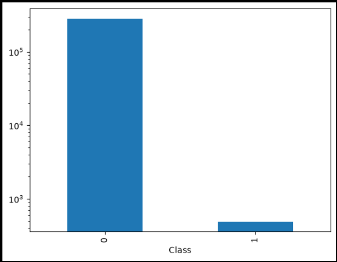
</p>

<br><br>

The dataset is highly imbalanced, with legitimate transactions significantly outnumbering fraudulent ones. This makes precision, recall, and PR-AUC important evaluation metrics.

### 2. Transaction Amount Distribution by Class

<p align="center">
  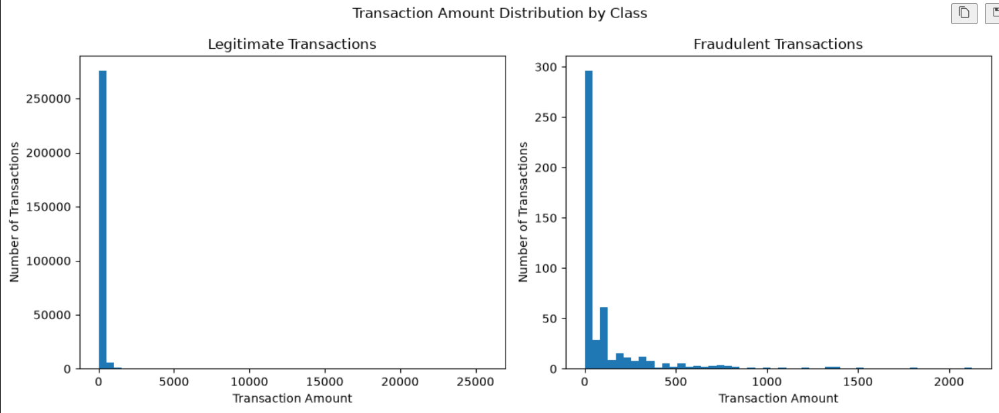
</p>

<br><br>
Both classes show right-skewed amount distributions, with most transactions involving smaller amounts. Fraudulent transactions occur across different amounts, so transaction value alone cannot reliably identify fraud.

### 3. Fraud Transaction Time Analysis

<p align="center">
  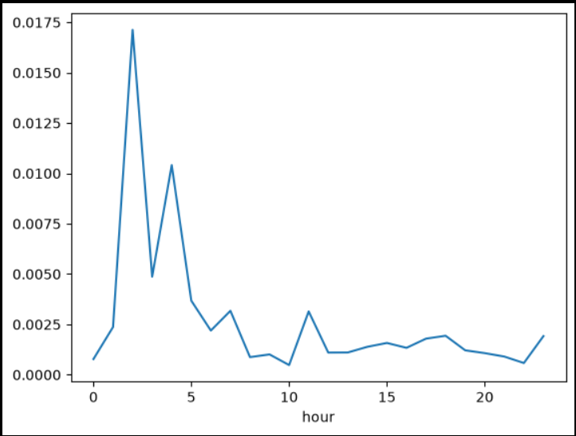
</p>

<br>

Transaction activity varies across elapsed-time intervals, suggesting potential temporal patterns that may help the model distinguish suspicious transactions.


---

## Feature Engineering

Feature engineering was performed to prepare the transaction data for model training and prediction.

The final model uses the following features:

- **V1–V28:** Anonymised numerical transaction features.
- **log_amount:** Logarithmic transformation of the transaction amount, calculated as `log(1 + Amount)`.
- **hour_sin and hour_cos:** Cyclical features derived from transaction elapsed time.

The time-based features are calculated as follows:

- `hour = floor(Time / 3600) % 24`
- `hour_sin = sin(2 * pi * hour / 24)`
- `hour_cos = cos(2 * pi * hour / 24)`

These transformations represent the time feature cyclically, allowing values near the beginning and end of the 24-hour cycle to be represented as close to each other.

The dataset was split chronologically into training, validation, and test sets to reduce the risk of temporal data leakage.

**Note:** The time-derived features are based on elapsed time in the dataset and do not represent verified real-world clock time.

---

## Model Development

Multiple classification algorithms were explored to compare their performance on the imbalanced dataset.

The models considered include:

1. Logistic Regression
2. Decision Tree Classifier
3. Random Forest Classifier
4. XGBoost Classifier

The models were evaluated using metrics that focus on fraud identification and the trade-off between false positives and missed fraud cases.

The final selected model is an XGBoost classifier, saved as `models/xgb_final.joblib`.

---

## Classifier Comparison

Comparing different algorithms helps assess their ability to identify fraudulent transactions and rank suspicious transactions effectively.

### 1. Model Performance Comparison

<p align="center">
  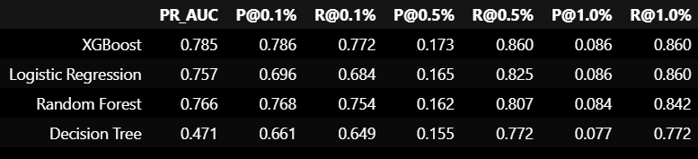
</p>

<br><br>

### 2. Precision-Recall Comparison


<p align="center">
  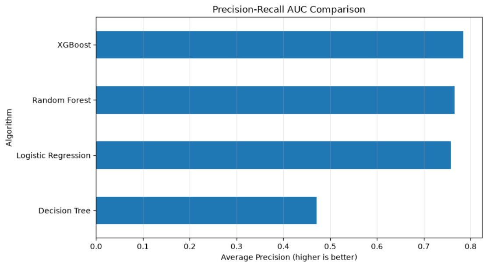
</p>

<br><br>


### 3. Confusion Matrix Comparison


<p align="center">
  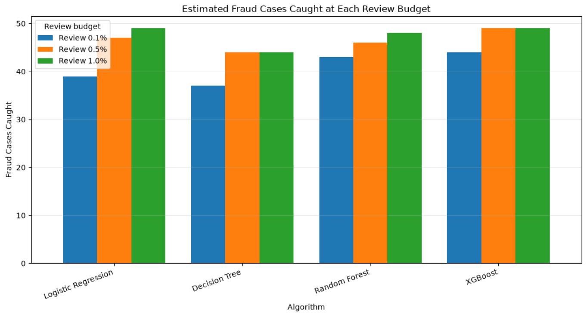
</p>

<br>

### Comparison Summary

The classifier comparison shows that XGBoost performs best overall, achieving the highest PR-AUC of 0.785, followed by Random Forest (0.766), Logistic Regression (0.757), and Decision Tree (0.471). XGBoost also captures the most fraud cases at the 0.1% review budget, while its performance remains competitive at higher review budgets. These results make XGBoost the preferred final model for this project, although the choice should also consider precision, recall, and the operational cost of false positives and missed fraud cases.

---

## Final Model and Results

XGBoost was selected as the final model for the fraud detection application. The trained model is saved and loaded by the Streamlit application for making predictions on uploaded transaction data.

### 1. Final Maodel Precision and Recall at Different Review Budgets

<p align="center">
  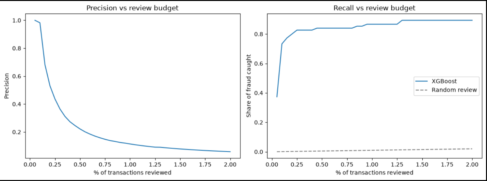
</p>

<br><br>

### 2. Score Distribution

<p align="center">
  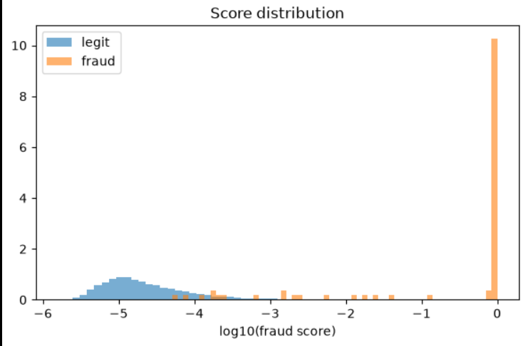
</p>

<br><br>

### 3. Test Results

<p align="center">
  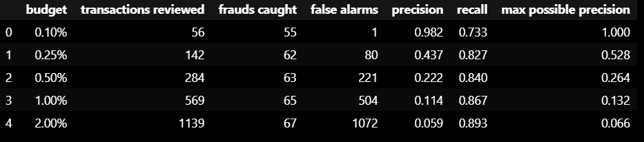
</p>

<br><br>

<p align="center">
  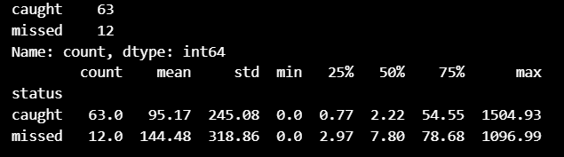
</p>

<br><br>

Record the metrics calculated on the held-out test set in the table below.

<p align="center">
  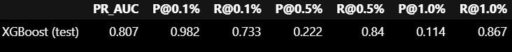
</p>

<br>

---

## Streamlit Application

An interactive Streamlit application was developed to make the trained model accessible through a simple web interface.

### Application Features

- Upload transaction data as a CSV file.
- Automatically recreate the engineered features required by the model.
- Generate fraud-risk scores for transactions.
- Adjust the threshold used to flag transactions for review.
- View scored transaction records.
- Download the scored output as a CSV file.
- Calculate optional evaluation metrics when ground-truth labels are available.

### Application Screenshots

**IMAGE: STREAMLIT APPLICATION HOMEPAGE**

**IMAGE: CSV UPLOAD INTERFACE**

**IMAGE: FRAUD SCORE AND REVIEW FLAG OUTPUT**

**IMAGE: STREAMLIT RESULTS AND EVALUATION METRICS**

**Live Application:** Add your Streamlit deployment URL here after deployment.

---

## Project Structure

```text
Fault detection/
│
├── app.py
├── requirements.txt
├── README.md
├── .gitignore
│
├── models/
│   └── xgb_final.joblib
│
├── src/
│   ├── data.py
│   └── metrics.py
│
├── notebooks/
│   ├── 01_EDA.ipynb
│   ├── 02_baselines.ipynb
│   ├── 03_supervised.ipynb
│   └── 04_xgb_final.ipynb
│
├── screenshots/
│   └── [Add your screenshots here]
│
└── data/
    └── raw/
        └── creditcard.csv
```

The structure above is illustrative. Update the notebook names and folders to match your actual repository. The raw dataset is excluded from Git.

---

## Evaluation Metrics

Because fraud detection involves severe class imbalance, multiple metrics are used to evaluate the model.

| Metric | Purpose |
|---|---|
| Precision | Measures how many transactions flagged as fraudulent are actually fraudulent |
| Recall | Measures how many actual fraudulent transactions are detected |
| PR-AUC / Average Precision | Summarises the precision-recall trade-off across prediction thresholds |
| Precision@K | Measures the proportion of fraud cases among the highest-risk K transactions |
| Recall@K | Measures the proportion of all fraud cases captured within the highest-risk K transactions |
| Fraud amount captured at K | Measures the share of the total fraudulent transaction amount represented among the top K transactions |

Precision and recall at K are useful for operational scenarios in which only a limited number of suspicious transactions can be reviewed.

---

## Limitations

- The dataset contains historical transactions and may not represent current fraud patterns.
- The anonymised features limit direct interpretation of the original transaction characteristics.
- The selected classification threshold affects the balance between missed fraud cases and false alarms.
- A high fraud-risk score is a model prediction, not proof that a transaction is fraudulent.
- Metrics calculated on uploaded data are meaningful only when reliable ground-truth labels are available.
- This project is a portfolio and learning project, not a production-ready financial security system.

---

## Future Improvements

- Hyperparameter tuning and systematic threshold selection.
- Additional evaluation using precision-recall curves and calibration analysis.
- Improved model explainability using SHAP or other feature-attribution methods.
- Monitoring for changes in transaction patterns over time.
- More comprehensive application testing and deployment.
- Evaluation on additional datasets to investigate generalisation.

---


*Developed as a machine learning project exploring imbalanced classification, fraud-risk scoring, and interactive model deployment.*